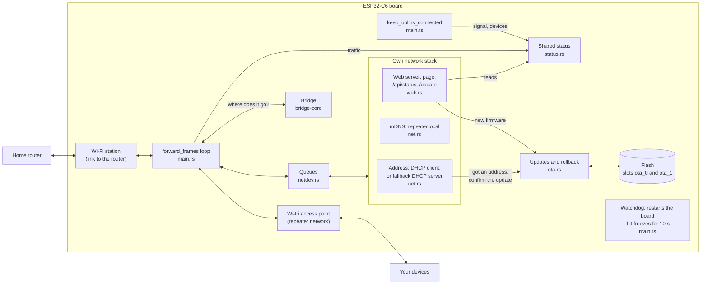
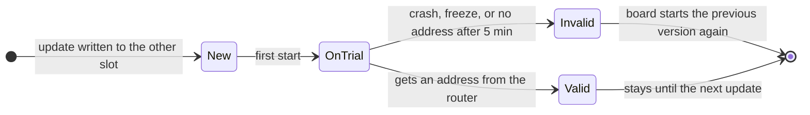

# ESP32-C6 Wi-Fi repeater (Rust)

> [!IMPORTANT]
> **This GitHub repository is only a mirror.** The real repository is on
> SourceHut: <https://git.sr.ht/~radium226/esp32-c6-wifi-repeater>.
> Nobody reads issues or pull requests on GitHub.

This is a Wi-Fi repeater for a small board, the Seeed XIAO ESP32-C6. It is
written in Rust and runs without an operating system.

Most cheap repeaters create a second network: your devices get different
addresses and can't see the other devices at home. This one is different.
Devices on the repeater get their address from your home router, like every
other device. So casting to a Chromecast or finding a printer still works.

It started as a port of [esp_wifi_repeater] (by martin-ger), which I used on an
older ESP8266 board. I test it with a Freebox router.

[esp_wifi_repeater]: https://github.com/martin-ger/esp_wifi_repeater

The code has two parts:
- `bridge-core/`: decides where each network packet goes. It doesn't depend on
  the hardware, so its tests run on a normal computer.
- `firmware/`: the program for the board. It sets up Wi-Fi, moves packets, and
  serves a status page and updates.

## How it works
A Wi-Fi device can only send packets with its own hardware address (MAC). So the
repeater can't simply pass packets through. Instead:
- Packets from your devices go to the router with the repeater's address. The
  repeater remembers which IP address belongs to which device.
- Packets from the router come to the repeater's address. The repeater looks at
  the IP address and sends each packet to the right device.
- When the router asks "who has this IP?", the repeater answers for its devices.
- Address requests (DHCP) go to your router, which gives out the addresses.
- Broadcasts (used to discover devices) go both ways.
- Only IPv4 works. IPv6 packets are dropped.

The board also has its own small network stack, for the status page and updates.
It only sees packets meant for it, so it doesn't slow down your devices.

## Architecture
Everything runs on the board's single core, as async tasks (Embassy). One loop,
`forward_frames`, moves every packet. It asks `bridge-core` where each packet
goes: to your devices, to the router, or to the board's own network stack.



An update goes into the slot that isn't running. The new version must prove it
works before it stays:



## Setup
1. Install [mise], Rust and `espflash` (`cargo install espflash --locked`). The
   Rust version is set in `firmware/rust-toolchain.toml`.
2. Copy `mise.local.toml.example` to `mise.local.toml` and fill it in: the home
   Wi-Fi to repeat, the name and password of the repeater's network, and a
   password for updates. Git ignores this file. The values go into the
   firmware when you build it.
3. Plug the board in with USB-C and run `mise run flash`. The board shows up as
   `/dev/ttyACM0` (set `ESP_PORT` if yours is different). After that, you can
   update it over Wi-Fi with `mise run ota`.

If you use an external antenna, set `EXTERNAL_ANTENNA` to `true` in
`firmware/src/bin/main.rs`.

[mise]: https://mise.jdx.dev

## Commands
All commands are mise tasks (`mise tasks` lists them). Builds use limited CPU
and memory, so your computer stays usable.
```sh
mise run build            # build the firmware
mise run flash            # build and write it to the board over USB
mise run ota              # build and install it over Wi-Fi
mise run run              # flash, then show 20 s of the board's log
mise run log              # show the board's log (LOG_SECONDS=n to stop after n s)
mise run test             # run the bridge-core tests
mise run check            # tests and lint
mise run status           # print the status as JSON
mise run open             # open the status page in your browser
mise run speed            # speed test through the repeater (see below)
mise run laptop-test      # full test through the repeater (see below)
mise run flash:no-uplink  # test build for the fallback mode; undo with `mise run flash`
mise run secrets          # create mise.local.toml from an old ESP8266 secrets.h
```
Don't run `log` while you flash: espflash can't use the USB port while it is
open. You can also run `cargo run --release` in `firmware/` (mise must be
active in your shell for the passwords). But it opens a log viewer that keeps
the board stuck in its bootloader.

`speed` and `laptop-test` are for a Linux laptop that uses wpa_supplicant. They
move the laptop to the repeater's network for about a minute, then always move
it back.

## Status page
Open `http://repeater.local/`, or the board's IP address (your router lists it
as `repeater`). The page shows:
- the connection to the home Wi-Fi: signal, channel, router
- traffic in both directions
- the connected devices: name, IP address, MAC, how long they've been connected
- the board: uptime, memory, temperature, firmware version

It refreshes every 2 seconds. Anyone on your network can see it, with no login.
It never shows passwords. The data comes from `/api/status`, in JSON.

More details:
- The board gets its own address from your router. To keep the same address,
  reserve one for it in the router's settings.
- `repeater.local` works through mDNS, which most computers and phones support.
- **Fallback mode**: if the home Wi-Fi is down for 30 seconds, the board uses
  the address 192.168.4.1 and gives addresses to devices on its own network. So
  you can still open the page from a phone and see what's wrong. When the home
  Wi-Fi comes back, it goes back to normal. While it waits, it only retries
  every 30 seconds, because each try briefly takes its own network offline.
- The device list may miss a device that connects while the board is
  reconnecting to the home Wi-Fi. The device shows up as soon as it sends data.

## Updates over Wi-Fi (OTA)
`mise run ota` builds the firmware and sends it to the board over Wi-Fi, with
the update password from `mise.local.toml`. Then it waits until the board has
restarted with the new version. It takes about 30 seconds. To skip
`repeater.local`, give the address: `OTA_HOST=192.168.1.x mise run ota`.

What keeps a bad update from breaking the board:
- The flash memory has two slots for the firmware. An update goes into the
  slot that isn't running, so the current version stays intact.
- After an update, the new version runs "on trial". It must connect to the home
  Wi-Fi and get an address within 5 minutes.
- If it doesn't, or if it crashes or freezes (a watchdog restarts the board
  after 10 seconds), the board goes back to the previous version.
- I tested this with an update that couldn't connect: it went back to the old
  version after 5 minutes.
- Flashing over USB (`mise run flash`) always writes the first slot and starts
  from it.

The board only accepts firmware made for the ESP32-C6 that fits in a slot. The
update is sent without encryption, so anyone on your network who knows the
password could install firmware.

## Speed
Measured with a laptop next to the board and a Freebox, using an online speed
test for 20 seconds each way. Results change a lot from one test to the next,
because many networks share the 2.4 GHz band.

| Firmware | Download (Mbit/s) | Upload (Mbit/s) |
|---|---|---|
| default driver settings | 0.33 | 0.28 |
| bigger driver queues (16) | 3.7-4.4 | 2.8-6.4 |
| bigger queues (32/64) and buffers | 6.7 | 8.0 |
| same, plus 20 MHz channel width (current) | 6.3-9.5 | 6.3-15.5 |
| tried, then removed: even bigger buffers | 5.6 | 8.0 |
| tried, then removed: grouping packets (A-MSDU) | 3.5 | 8.5 |
| laptop directly on the Freebox's 2.4 GHz Wi-Fi | 48 | 36-57 |

What made the difference:
- The Wi-Fi driver limits how many packets can wait to be sent, for both
  networks together. When that limit was reached, it also stopped receiving.
  Bigger queues fixed most of the problem.
- The Freebox's 2.4 GHz Wi-Fi only uses 20 MHz channels. The repeater used
  40 MHz by default, which slowed it down. It now uses 20 MHz.
- The board sends at 15 dBm. At the driver's default (5 dBm), the Freebox
  never answered.
- The board has one antenna and sends every packet twice on the same channel:
  once to your device and once to the router. So about 10-15 Mbit/s is the
  most to expect.

## License
[Beerware](LICENSE): do what you want with it. If we meet some day and you
think it was worth it, you can buy me a beer.
